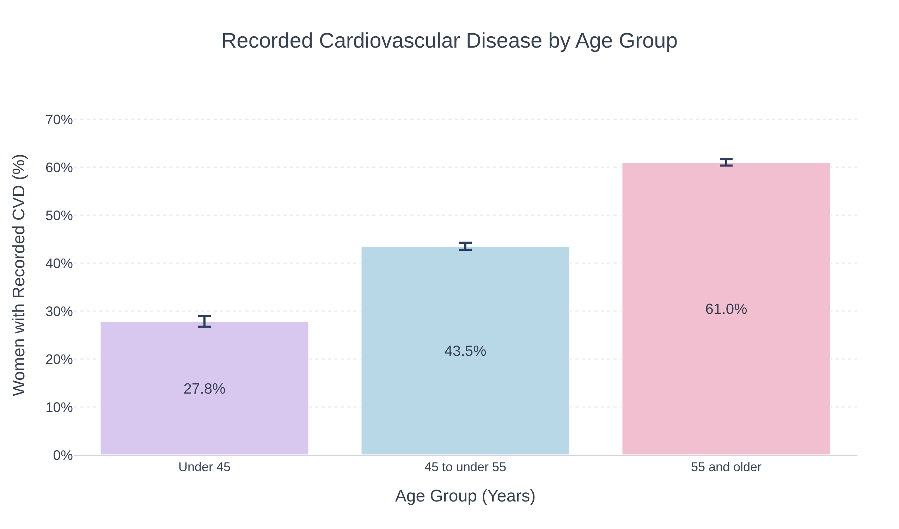
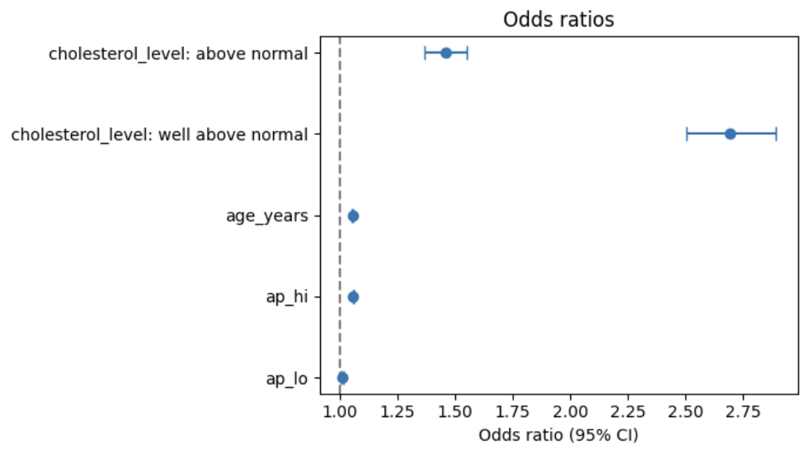
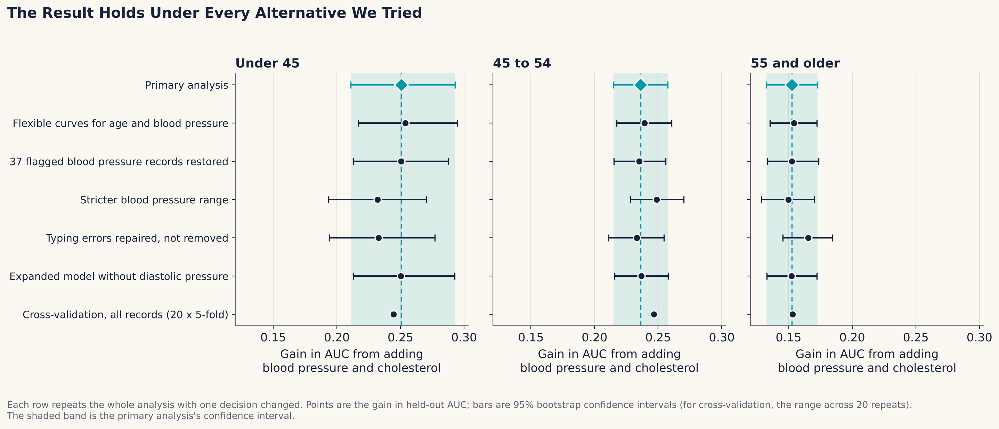

# The Unseen Heart: What Age Alone Cannot Tell Us

**In 44,727 exam records from women, blood pressure and cholesterol said the most about who carried a heart disease label before age 55 and the least after it. At every age, about 3 in 10 labeled records looked unremarkable on both.**

By Team Heartthrobs: Padmaja Krishna Singh, Kimmone Bartley, Lucy Xie and Vasu Jetly

> This student analysis is for research and education. It is not medical advice or a diagnostic tool.

*Figure 1. How well two models separate exam records with and without a recorded cardiovascular disease label, by age group. The coral circle is a model that knows only a woman's age. The teal diamond is a model that also knows her blood pressure and cholesterol category. A score of 0.5 is a coin flip and 1.0 is perfect. The gain is 0.25 under 45, 0.24 at 45 to 54 and 0.15 at 55 and older. Bars are 95% confidence intervals from 2,000 bootstrap resamples of 8,946 records the models never saw.*

## Introduction

Picture two women at a routine exam. A nurse wraps a cuff around each woman's arm and writes down two numbers. A blood sample goes to the lab for cholesterol. Now suppose one of the women has cardiovascular disease (CVD), meaning disease of the heart and blood vessels, and the other does not. How much do those routine numbers help tell them apart?

The usual answer is "quite a lot," but that answer hides something. Age is the strongest single signal of heart disease, so any tool that knows a woman's age already looks clever. The harder and more useful question is what the measurements add once age is known, and whether they add the same amount for a woman of 40 as for a woman of 60.

That question matters for women in particular. CVD is a leading cause of death for women. In the United States in 2023 it was the cause of death for 433,254 women, 47.3% of all CVD deaths ([American Heart Association, 2026](https://www.heart.org/-/media/PHD-Files-2/Science-News/2/2026-Heart-and-Stroke-Stat-Update/Translations/English/2026-Stats-Update-Fact-Sheet-US-Females-and-CVD_final.pdf?sc_lang=en)). Yet women made up only 38% of participants in 740 cardiovascular trials completed between 2010 and 2017 ([Jin et al., 2020](https://doi.org/10.1161/CIRCULATIONAHA.119.043594)), so the tools built from that evidence have been tested less thoroughly in women than in men.

So we asked: **among women's exam records, how much do blood pressure and cholesterol improve our ability to tell records with a CVD label from records without one, beyond age alone, and does that improvement differ by age group?**

Here is what you are in for: one dataset, two simple models, three age groups, and an answer that is clear in one direction and humbling in another.

## The Data and Our Methods

We used the [Cardiovascular Disease Dataset](https://www.kaggle.com/datasets/sulianova/cardiovascular-disease-dataset) supplied by the datathon: 70,000 exam records, of which 45,530 are coded as women. We removed 766 records with unusable blood pressure readings and set aside 37 more whose readings fell outside a plausible range, leaving 44,727 women aged 29.7 to 64.9 (every rule and count is in our [cleaning log](cleaning_log.md)). We then compared two logistic regression models, a standard method for yes-or-no outcomes: one using age alone, and one using age, both blood pressure numbers and cholesterol category. Both learned from the same 80% of the records and were tested on the same remaining 20% (a random split, balanced by age group and label, with a fixed seed), which we divided into three age groups: under 45, 45 to 54, and 55 and older. Three limits apply to everything below. "Recorded CVD" is a label noted at the same exam, not a future diagnosis, and the source does not say how it was assigned. The file does not say where or how the records were collected. And sex is recorded as one binary code. Our age groups describe age only; menopause status was not measured.

## What We Found

### Age sets the backdrop

The older the women in the file, the more of their records carry a CVD label.

*Figure 2 (by Lu). Share of records with recorded CVD in each age group: 1,743 of 6,263 women under 45 (27.8%), 7,952 of 18,273 at 45 to 54 (43.5%) and 12,316 of 20,191 at 55 and older (61.0%). This is the share in this dataset, where about half of all records carry the label. It is not the rate of CVD among women in any population.*

This is why age alone makes a model look capable. Across all women, a model that knows nothing but age ranks a labeled record above an unlabeled one 65% of the time. That measure is called the AUC: pick one record with the label and one without, at random, and the AUC is how often the model gives the higher score to the one with the label. A coin flip scores 0.5.

But compare women of similar age and the advantage nearly vanishes. Inside our three age groups, the age-only model scores 0.55 to 0.58, not far from a coin.

### The same blood pressure means something different at 40 and at 60

Before any modeling, the raw patterns already hint at the answer. The top of Figure 3 summarizes the 44,727 records we kept; the four plots below it show how the share of records with a CVD label changes with age, systolic pressure, diastolic pressure and cholesterol.

*Figure 3 (by Lu). Summary statistics for the 44,727 records kept for analysis (top) and the share of records with recorded CVD by age, systolic pressure (`ap_hi`), diastolic pressure (`ap_lo`) and cholesterol level (bottom). Blood pressure points are group averages. These are associations in exam records and do not show that either measurement causes CVD.*

The share rises with every measurement, and the systolic curve climbs steeply and then flattens above about 140. Splitting the same records by age group (`outputs/` tables) shows why that matters. At a systolic pressure under 120, 11% of records from women under 45 carry the label, against 37% for women 55 and older. From 140 upward the three age groups converge: 83% to 87% at every age.

**At high blood pressure, age hardly matters. At normal blood pressure, it matters a lot.** For the youngest women, blood pressure sorts records cleanly into "rarely labeled" and "usually labeled." For the oldest, many records are labeled even when the reading is normal.

### The main result: the measurements add less for the oldest women

Figure 1 shows the scores and Figure 4 shows the gain in each age group. Adding blood pressure and cholesterol lifts the AUC:

- from 0.585 to 0.835 for women under 45, a gain of 0.251 (95% confidence interval 0.211 to 0.293)
- from 0.549 to 0.786 for women 45 to 54, a gain of 0.236 (0.215 to 0.258)
- from 0.575 to 0.728 for women 55 and older, a gain of 0.153 (0.133 to 0.173)

*Figure 4 (by Lu). Change in held-out AUC from the age-only model to the model with blood pressure and cholesterol, by age group. Confidence intervals for these gains are in the text and in Figure 1.*

A gain of 0.25 means that out of every 100 pairs of records, one labeled and one not, the model now ranks about 25 more in the right order.

Is the difference between age groups real, or could it be chance? Eyeballing three intervals is not a fair test, so we calculated the uncertainty of the *difference* itself, resampling the held-out women 2,000 times while keeping each woman's two model scores together.

- **Under 45 versus 55 and older:** the gain is larger by 0.10 (95% confidence interval 0.05 to 0.15).
- **45 to 54 versus 55 and older:** the gain is larger by 0.08 (0.05 to 0.11).
- **Under 45 versus 45 to 54:** the difference is 0.01 (−0.03 to 0.06).

The first two intervals stay clear of zero. The third straddles it, so **we do not claim the two younger groups differ.** What the data support is a step down at 55, not a steady decline with every birthday.

Nearly all of the gain comes from blood pressure. Blood pressure alone reaches almost the same AUC as the full model, while cholesterol on its own adds 0.05 to 0.07. And when we gave the model everything else in the file (glucose, smoking, alcohol, physical activity and weight) the AUC rose by less than 0.01 in every age group. Whatever would help tell older women's records apart is not among the recorded variables.

### A second way to see it: odds ratios

An AUC describes a whole model. An odds ratio describes one variable: how much the odds of carrying the label rise with it, holding the others fixed. An odds ratio of 1 means no association, and 2 means twice the odds.

*Figure 5 (by Lu). Odds ratios for recorded CVD from logistic regression on all 44,727 records, each adjusted for the other variables shown. Age and blood pressure are per year and per mmHg, so their dots sit close to 1; the cholesterol categories are compared with normal. Bars are 95% confidence intervals. These are associations, not causal effects.*

Across all women, cholesterol "well above normal" went with 2.69 times the odds of recorded CVD compared with normal cholesterol (95% confidence interval 2.50 to 2.90), after accounting for age and both blood pressure readings. Each additional 10 mmHg of systolic pressure went with 1.77 times the odds (1.73 to 1.81), which is the roughly 1.06 per mmHg that the figure shows.

Fitting the same model within each age group, an exploratory step we added after seeing the calibration result below, the systolic odds ratio per 10 mmHg was 2.36 under 45, 1.91 at 45 to 54 and 1.57 at 55 and older, and the three intervals do not overlap (`outputs/odds_ratios.csv`). It is the same finding in a different unit.

### An unexpected result: one model does not fit all ages

A good model should also be calibrated: of the records it scores at 30%, about 30% should carry the label. We checked this on the held-out records (`outputs/calibration.csv`).

Across all women our model is well calibrated. Within age groups it is not. For women under 45 the scores are too cautious: the group it scored highest, at about 64% on average, had recorded CVD 87% of the time. For women 55 and older the scores are too bold: the group scored at about 92% had recorded CVD 85% of the time. Agreement with a recorded label is not validation for predicting future disease.

We did not expect this, and it follows from the main finding. A single model assumes 10 mmHg means the same thing at every age, and the data say otherwise. **A score can be right on average and still be wrong for a particular group of women.** Anyone building a risk tool from data like these should check it group by group.

### Does the result survive other choices?

Every analysis involves judgment calls. We repeated ours with each call changed.

*Figure 6. The gain in AUC from adding blood pressure and cholesterol, under seven versions of the analysis. Bars are 95% confidence intervals; for cross-validation, the range across 20 repeats. The shaded band is the primary analysis's interval.*

Putting the 37 set-aside blood pressure records back changed no gain by more than 0.002. A stricter blood pressure range, repairing obvious typing errors instead of removing those records, a more flexible model, dropping the diastolic number, and retesting on every record in turn (cross-validation) all left the pattern in place: similar gains under 55, a smaller gain at 55 and older.

## Unanswered Questions

**The unseen part.** At every age, about 3 in 10 records with recorded CVD had a systolic pressure under 130 and normal cholesterol (31% under 45, 30% at 45 to 54 and 28% at 55 and older). On the measurements we studied, those records look unremarkable. Among women under 45, about a third of labeled records (36%) landed in the bottom quarter of our model's scores. These are records the model ranks low, not "missed diagnoses," but they mark the edge of what routine numbers can see.

**Why is the signal weaker in older women?** The data cannot say. Here we are speculating. Women who already have a diagnosis may be taking medicine that lowers their blood pressure, which would blur the link, and treatment is not recorded. Heart disease also has more routes as people age, and a blood pressure reading and a cholesterol category may capture a smaller share of them.

**What is the label?** The source does not define "CVD." If it includes a diagnosis of high blood pressure, then blood pressure is partly measuring the outcome itself, and our AUCs overstate how much it reveals about heart disease. This is the biggest caveat on the *size* of our gains. We do not see how it would produce the *difference* between ages, but we cannot rule it out.

**What about the heart conditions these numbers were never going to catch?** Spontaneous coronary artery dissection, or SCAD, is a tear in the wall of a heart artery. The American Heart Association describes it as an important cause of heart attack, particularly among young women with few conventional risk factors ([Hayes et al., 2018](https://doi.org/10.1161/CIR.0000000000000564)). Our data cannot identify SCAD or any other specific condition, and we make no claim about it. We mention it because it shows why "normal numbers" and "healthy heart" are not the same statement.

**Menopause, pregnancy and time.** The file has no menopause status, no pregnancy history and no follow-up. We cannot say whether the step at 55 is about hormones, about years lived, or about who ended up in the dataset.

## Conclusions, Limitations and Next Steps

**What the data showed.** In these records, knowing a woman's blood pressure and cholesterol improved a model's ability to pick out records with recorded CVD at every age. The improvement was about the same for women under 45 and women 45 to 54, and clearly smaller for women 55 and older. A single model for all ages was accurate on average but too cautious for the youngest women and too bold for the oldest.

**Where that leaves our question.** Does the added value differ by age? Yes, between women 55 and older and the two younger groups. Between the two younger groups, the data leave the ordering open.

**Limitations.**

- The outcome is CVD recorded at the exam. Nothing here predicts who will develop heart disease.
- We do not know how that label was assigned, or where, when and from whom the records were collected. About half of the records carry the label, far more than in any general population, and the file covers ages 29 to 64 only.
- These are associations, not causes. Treatment is not recorded.
- Age groups describe age. Menopause status was not measured.
- Sex is recorded as a single binary code, so the findings do not extend to people outside the two recorded categories.
- Cholesterol is three broad categories and blood pressure is a single reading, mostly rounded to the nearest 10.
- Our confidence intervals capture sampling uncertainty only, not the unknowns above.

**With more time or resources** we would test the finding in a dataset with a documented outcome and follow-up over time, so that "telling labeled records apart" could become "predicting an event." We would want treatment, menopause and pregnancy history. And we would build and test a model that lets blood pressure count differently at different ages, checking calibration in each group.

## Data and Code

- Repository: [github.com/lxie0682/cvd-women-Heartthrobs](https://github.com/lxie0682/cvd-women-Heartthrobs). The notebooks in `track-02/team/notebooks` clean the data and fit the models; `track-02/team/src/article_analysis.py` reproduces every number and figure in this article.
- Full numerical results: [results_summary.md](results_summary.md). Cleaning rules and counts: [cleaning_log.md](cleaning_log.md).
- Data: Ulianova S. [Cardiovascular Disease dataset](https://www.kaggle.com/datasets/sulianova/cardiovascular-disease-dataset). Kaggle, 2019, as distributed in the [OpenBio 2026 Datathon repository](https://github.com/Harvard-Undergraduate-OpenBio/openbio-datathon-2026). The records contain no names or other identifying details.
- Sources cited: American Heart Association. [2026 Heart Disease and Stroke Statistics, fact sheet: Females and Cardiovascular Diseases](https://www.heart.org/-/media/PHD-Files-2/Science-News/2/2026-Heart-and-Stroke-Stat-Update/Translations/English/2026-Stats-Update-Fact-Sheet-US-Females-and-CVD_final.pdf?sc_lang=en). 2026. Jin X, et al. [Women's Participation in Cardiovascular Clinical Trials From 2010 to 2017](https://doi.org/10.1161/CIRCULATIONAHA.119.043594). Circulation. 2020. Hayes SN, et al. [Spontaneous Coronary Artery Dissection: Current State of the Science](https://doi.org/10.1161/CIR.0000000000000564). Circulation. 2018.
- Tools: pandas, NumPy, statsmodels, scikit-learn, SciPy and matplotlib. Figures 2 to 5 were made by teammate Lu; Figures 1 and 6 are generated by `track-02/team/src/article_analysis.py`.

## Acknowledgements

We thank the Harvard Undergraduate OpenBio organizers for the data package, starter notebooks and guidance, and the Harvard Undergraduate Data Project for the article guide this piece follows. We used Claude (Anthropic) to help write analysis code and draft this article; the team checked every number against the data.

---

*This student analysis is for research and education. It is not medical advice or a diagnostic tool.*
